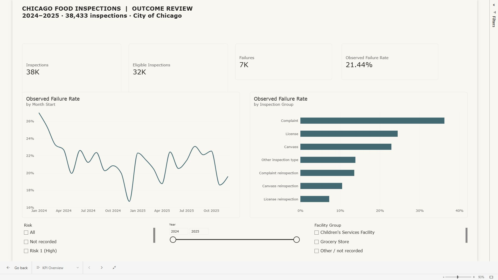
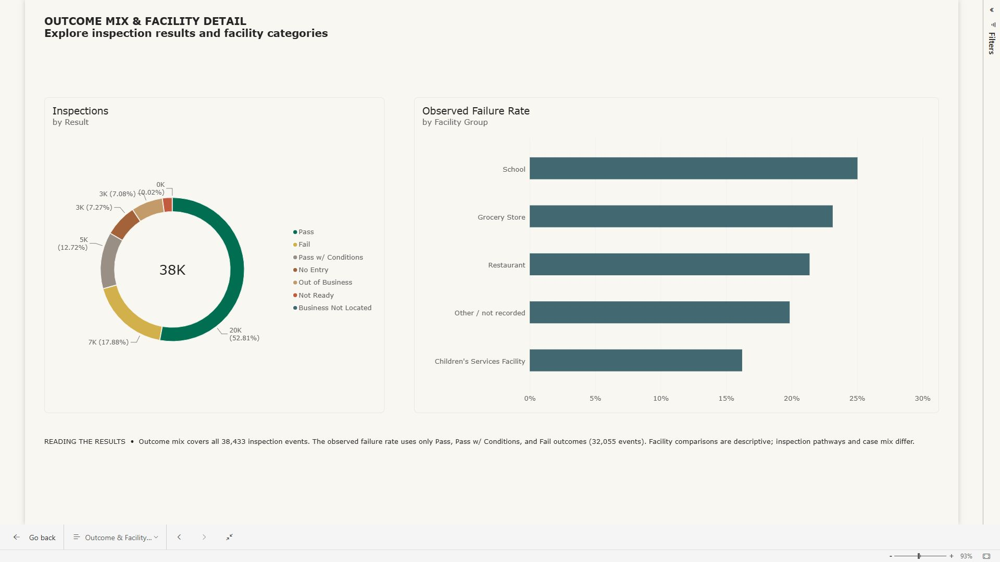

# Chicago Food Inspections | Power BI Outcome Review

An interactive, inspection-level review of Chicago food-inspection outcomes in **2024–2025**. The report is designed for a public-health operations question: **How do observed failure rates vary over time and across inspection pathways, while keeping the denominator and case mix visible?**

> **Scope:** 38,433 inspection records dated 1 January 2024 through 31 December 2025 from the [City of Chicago Food Inspections dataset](https://data.cityofchicago.org/Health-Human-Services/Food-Inspections/4ijn-s7e5). Extracted 30 October 2026. The source is updated over time; reruns may differ.

## At a glance

| Measure | Value | Definition |
| --- | ---: | --- |
| Inspection records | 38,433 | One row per unique inspection ID in the extract |
| Outcome-eligible inspections | 32,055 | `Pass`, `Pass w/ Conditions`, or `Fail` |
| Failures | 6,872 | `Fail` among outcome-eligible inspections |
| Observed failure rate | **21.44%** | 6,872 ÷ 32,055 |
| Other result records | 6,378 | `No Entry`, `Out of Business`, `Not Ready`, or `Business Not Located`; excluded from the failure-rate denominator |

## Dashboard

The two-page [Power BI report](https://app.powerbi.com/groups/me/reports/d2d47cb2-4402-4522-ae2d-24750566e28b/83a2948447d922879021?experience=power-bi) pairs an interactive KPI overview with an outcome and facility detail page. The Power BI service link may require access to my workspace; the previews below are public.

**KPI Overview** displays inspection count, outcome-eligible count, failures, and observed failure rate. A monthly trend and inspection-group comparison respond to risk, year, and facility-group slicers. I verified the year slicer against the source calculations: selecting 2024 displays **21.76%**, and restoring 2024–2025 displays **21.44%**.



**Outcome & Facility Detail** shows the distribution of all recorded results and observed failure rates by facility group. The donut includes non-outcome statuses, while the facility rate excludes them from its denominator.



The screenshots are a dated report snapshot. The interactive report is backed by the curated CSV in this repository; the screenshots and source extract do not refresh automatically.

### What the analysis shows

1. **The overall rate moved modestly.** Among outcome-eligible inspections, the observed failure rate was **21.76% in 2024** (3,481 / 15,995) and **21.11% in 2025** (3,391 / 16,060), a **0.65 percentage-point decrease**. This is a descriptive comparison, not evidence of a program effect.
2. **Inspection pathway matters to interpretation.** Complaint inspections had a **36.22%** observed failure rate (1,120 / 3,092), compared with **22.89%** for canvass inspections (3,882 / 16,958). Complaints are not a random sample of establishments, so the gap should not be interpreted as the effect of either pathway.
3. **A meaningful denominator is essential.** The 6,378 non-outcome records represent **16.60%** of all extracted rows. Including them as passes would understate the observed failure rate.

See [Findings and caveats](reports/FINDINGS.md) and [Metric definitions](reports/METRIC_DEFINITIONS.md) for the full interpretation.

## Reproduce the analysis

```bash
python scripts/fetch_data.py
python scripts/analyze.py
```

Both scripts use the Python standard library. The fetch script queries the City of Chicago's public Socrata endpoint in a bounded, ordered 2024–2025 window; it checks the API count against the downloaded count. The analysis script checks unique inspection IDs, writes a Power BI-ready CSV, and produces grouped summaries in [`analysis/summary.json`](analysis/summary.json).

The repository includes the curated [`data/inspections_analysis.csv`](data/inspections_analysis.csv), containing date, result, risk, facility and inspection groups, ZIP, and outcome flags. It omits establishment names, street addresses, and free-text violation narratives. The raw local extract is ignored; rerun `fetch_data.py` to retrieve it.

## Method and limitations

- **Unit of analysis:** inspection event, not establishment. The same establishment can be inspected more than once.
- **Rate denominator:** only inspections with a recorded Pass, Pass w/ Conditions, or Fail outcome. Non-outcome results are reported separately.
- **Comparisons:** inspection type, facility, and risk groups have different selection and follow-up patterns. Reinspection rates cannot be read as a causal improvement estimate.
- **Source revisions:** the City's dataset can be corrected after extraction. The project records the extract window and row count for reproducibility.
- **Policy context:** the City notes a procedure change on 1 July 2018; this analysis uses only 2024–2025 to avoid mixing pre-change and post-change observations.

## Project files

| Path | Purpose |
| --- | --- |
| [`scripts/fetch_data.py`](scripts/fetch_data.py) | Reproducible source extraction |
| [`scripts/analyze.py`](scripts/analyze.py) | Validation, group definitions, and metric summaries |
| [`data/inspections_analysis.csv`](data/inspections_analysis.csv) | Curated report input |
| [`data/extract_metadata.json`](data/extract_metadata.json) | Source URL, fields, extract window, source count |
| [`analysis/summary.json`](analysis/summary.json) | Independently calculated KPI and segment totals |
| [`reports/FINDINGS.md`](reports/FINDINGS.md) | Stakeholder-facing interpretation and limits |
| [`visuals/kpi-overview.png`](visuals/kpi-overview.png) | Public preview of the KPI overview |
| [`visuals/outcome-facility-detail.png`](visuals/outcome-facility-detail.png) | Public preview of outcome and facility views |

**Source:** City of Chicago, [Food Inspections](https://data.cityofchicago.org/Health-Human-Services/Food-Inspections/4ijn-s7e5). The City's published inspection result reflects what the inspector recorded at that inspection and may differ at another time. Duplicate reports can still occur in the source; this extract had unique inspection IDs.


